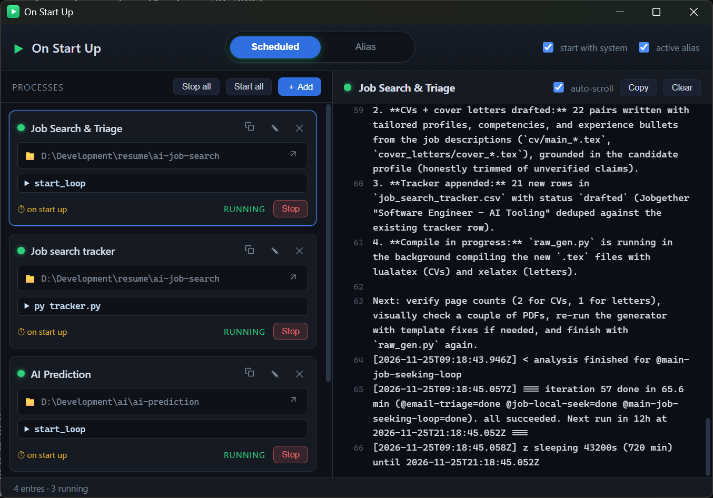
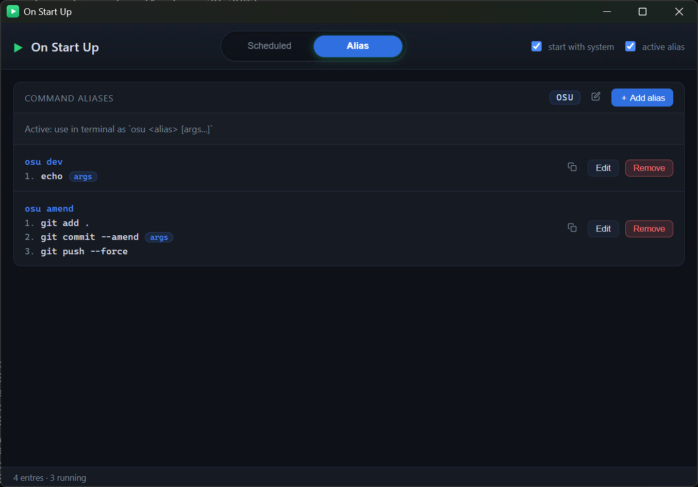

<p align="center">
  
</p>

<h1 align="center">On Start Up</h1>

<p align="center">
  Auto-launch, watch, and alias your commands. Run processes at login or on a schedule, monitor live output, and create terminal aliases from one desktop app.
</p>

## Screenshots

<p align="center">
  
  
</p>

## Capabilities

### Scheduled processes
- **Triggers**: Run entries on startup, once, daily, or on selected weekdays.
- **Process controls**: Start, stop, start all, stop all, edit, duplicate, and remove entries.
- **Live console**: Stream stdout/stderr/sys logs per process with visible line numbering, copy, clear, and auto-scroll.
- **Working directory & command**: Configure the command and optional working directory for each entry.

### Reliability & alerts
- **Error policies**: On unexpected non-zero exit, use Default, Stop future runs, or Rerun (with retry count, delay, and optional backoff).
- **Error popup**: Optional popup showing exit code and recent stderr output.
- **Sound alerts**: Optional start/exit/error tones, including custom imported sounds.

### Command aliases
- **Alias tab**: Create, edit, duplicate, and remove command aliases.
- **Terminal command**: Run aliases as `<command> <alias> [args...]` (default command: `osu`).
- **Editable command name**: Change the registered CLI command name from the Alias tab.
- **Active alias**: Enable/disable PATH registration for the alias command from the top bar.
- **Cross-platform shim**: Windows registers a `.cmd`/PowerShell shim; Unix/macOS/Linux installs an executable Python 3 shim and adds the bin directory to shell profile PATH.

### Desktop app behavior
- **Background service**: UI manages a local background service; closing the window does not stop managed processes.
- **Start with system**: Register the app/service to start at login.
- **Tray & local UI**: Tauri desktop UI with tray/server integration and local HTTP/SSE service communication.

## Install

**Windows (PowerShell)**
```powershell
iwr -useb https://on-start-up.seremtitus.co.ke/install.ps1 | iex
```

**Linux / macOS**
```bash
curl -fsSL https://on-start-up.seremtitus.co.ke/install.sh | bash
```

Launch **On Start Up** from your applications menu. On first run it registers itself to start at login (toggle **start with system** in the UI).  
Uninstall: run the generated `uninstall.ps1` / `uninstall.sh` in the install directory.

## Build from source

```sh
bun install
cargo xtask build --release   # or: cargo xtask build (debug)
```

Produces standalone binaries in `target/<profile>/` (`on-start-up` UI, `on-start-up-server`, and `on-start-up-error-popup`). Keep them together.

To rebuild and (re)launch locally in one step:

```sh
cargo xtask start             # release by default: kills existing, builds, starts backend + UI
cargo xtask start --debug     # debug build/run
```

## Config & platform

- **Config:** `<config dir>/com.seremtitus.onstartup/on-start-up.json`  
  (Windows: `%APPDATA%\com.seremtitus.onstartup\`, Linux: `~/.config/com.seremtitus.onstartup/`, macOS: `~/Library/Application Support/com.seremtitus.onstartup/`)
- **Alias shims:** `<config dir>/com.seremtitus.onstartup/bin/` (created when Active alias is enabled)

## License

Dual-licensed under [MIT](LICENSE-MIT) or [Apache-2.0](LICENSE-APACHE), at your option. Contributions are dual-licensed under the same terms unless stated otherwise.
